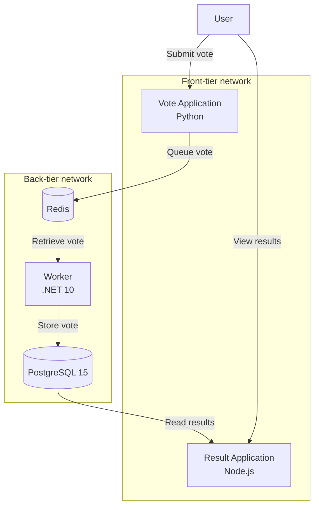

# Docker Voting App — DevOps Capstone

A containerized voting application demonstrating DevOps practices through Docker, Docker Compose, GitHub Actions CI/CD, automated integration testing, and container vulnerability scanning.

This project is based on the [Docker Samples Example Voting App](https://github.com/dockersamples/example-voting-app). The original application and its components belong to their respective contributors.

## Project Overview

The application allows users to vote between Cats and Dogs. Votes are temporarily stored in Redis, processed by a .NET Worker, persisted in PostgreSQL, and displayed through a Node.js results application.

The project focuses on:

- Multi-container orchestration with Docker Compose.
- Container networking and service discovery.
- Health checks and service dependencies.
- Persistent database storage.
- Automated CI/CD using GitHub Actions.
- Integration testing.
- Container image vulnerability scanning with Trivy.
- Dependency and runtime security improvements.

## Architecture

The application consists of five services:

| Service | Technology | Responsibility |
|---|---|---|
| Vote | Python | Accepts votes through the web interface |
| Redis | Redis | Temporarily queues submitted votes |
| Worker | .NET 10 | Processes votes and stores them in PostgreSQL |
| Database | PostgreSQL 15 | Persistently stores voting records |
| Result | Node.js | Displays voting results |

### Architecture diagram



### Vote processing flow

1. A user submits a vote through the Vote application.
2. The Vote application sends the vote to Redis.
3. The Worker retrieves the vote from Redis.
4. The Worker processes the vote and stores it in PostgreSQL.
5. The Result application displays the voting results.

## Technology Stack

- **Containerization:** Docker
- **Orchestration:** Docker Compose
- **Vote application:** Python
- **Result application:** Node.js
- **Background processing:** .NET 10
- **Message queue:** Redis
- **Database:** PostgreSQL 15
- **CI/CD:** GitHub Actions
- **Security scanning:** Trivy
- **Image registry:** GitHub Container Registry (GHCR)
- **Version control:** Git and GitHub

## Repository Structure

```text
example-voting-app/
│
├── .github/
│   └── workflows/
│       ├── ci.yml
│       ├── call-docker-build-vote.yaml
│       ├── call-docker-build-result.yaml
│       └── call-docker-build-worker.yaml
│
├── vote/
│   ├── Dockerfile
│   └── ...
│
├── result/
│   ├── Dockerfile
│   ├── package.json
│   └── package-lock.json
│
├── worker/
│   ├── Dockerfile
│   ├── Program.cs
│   └── Worker.csproj
│
├── compose.yaml
└── README.md
```

## Prerequisites

- Docker Engine
- Docker Compose
- Git
- Access to the Docker daemon
- Internet connectivity for downloading container images and dependencies

## Run Locally

Clone the repository:

```bash
git clone https://github.com/Mclina/example-voting-app.git

cd example-voting-app
```

Validate the Docker Compose configuration:

```bash
sudo docker compose config -q
```

Build the images and start the services:

```bash
sudo docker compose up -d --build
```

Check service status:

```bash
sudo docker compose ps
```

View application logs:

```bash
sudo docker compose logs --tail=50
```

## Access the Application

| Application | URL |
|---|---|
| Voting interface | http://localhost:8080 |
| Results interface | http://localhost:8081 |

Submit a vote through the voting interface and visit the results page to see the updated results.

## Testing

### Manual endpoint testing

Check that the Vote application responds:

```bash
curl -f http://localhost:8080/
```

Check that the Result application responds:

```bash
curl -f http://localhost:8081/
```

### End-to-end vote testing

Submit a test vote:

```bash
curl -i -c /tmp/vote-cookies \
  -d "vote=a" \
  http://localhost:8080/
```

Check that the vote has been stored in PostgreSQL:

```bash
sudo docker compose exec -T db \
  psql -U postgres -d postgres \
  -c "SELECT id, vote FROM votes;"
```

This verifies the integration between the Vote application, Redis, the Worker, and PostgreSQL.

## CI/CD Pipeline

GitHub Actions automates configuration validation, application testing, image building, and security scanning.

### Voting App CI

The CI workflow performs:

1. Docker Compose configuration validation.
2. Application image builds.
3. Application startup in the GitHub Actions runner.
4. Vote and Result endpoint checks.
5. Test vote submission.
6. Verification that the submitted vote is stored in PostgreSQL.
7. Trivy vulnerability scans of the Vote, Result, and Worker images.

### Docker Image Build Workflows

Separate reusable GitHub Actions workflows build the Vote, Result, and Worker images.

The images are published to GitHub Container Registry (GHCR).

The build workflows use multi-platform builds where supported by the respective application images.

## Container Security and Vulnerability Remediation

Trivy is used to scan container images for operating-system and application dependency vulnerabilities.

The project includes the following security improvements.

### Vote image

Updated Python packaging tools:

- setuptools
- wheel

The updates addressed the previously identified CVE-2026-23949 and CVE-2026-24049 findings.

### Result image

- Upgraded the base image from Node.js 18 to Node.js 24.
- Updated the application dependency lockfile.
- Removed npm and npx from the final runtime image after application dependencies were installed.
- Verified that Node.js, nodemon, and application dependencies remained functional.

The latest verified scan showed zero vulnerabilities in the Debian operating-system packages and all displayed Node.js package entries.

### Worker image

The Worker was upgraded from .NET 7 to .NET 10.

Dependency updates:

| Package | Previous version | Updated version |
|---|---:|---:|
| StackExchange.Redis | 2.2.4 | 2.13.17 |
| Npgsql | 4.1.9 | 10.0.3 |
| Newtonsoft.Json | 13.0.1 | 13.0.4 |

The upgrade also removed the previously detected vulnerable System.Drawing.Common 5.0.0 dependency.

### Verified Worker security scan

The latest Worker Trivy scan, performed on October 30, 2026, reported:

| Scan target | Vulnerabilities |
|---|---:|
| Ubuntu 24.04 operating system | 0 |
| Worker dependencies | 0 |
| .NET 10.0.14 runtime | 0 |

**Total detected vulnerabilities: 0**

Security scan results describe the image and database state at the time of scanning; they should be reviewed again as new vulnerabilities are disclosed.

**CI scanning note:** The current Trivy workflow uses `exit-code: '0'`. This allows the workflow to complete successfully even when findings are reported. The scan output must therefore be reviewed separately rather than treating a green workflow as proof of zero vulnerabilities.

## Health Checks and Networking

Docker Compose defines health checks for the Vote, Redis, and PostgreSQL services.

The Result service waits for PostgreSQL to become healthy, while the Worker waits for Redis and PostgreSQL.

The application uses two Docker networks:

- `front-tier` connects the web-facing Vote and Result services.
- `back-tier` connects the application services to their supporting data services.

PostgreSQL data is stored in the named Docker volume `db-data`. This allows database files to persist when the database container is recreated.

## Troubleshooting

### Check service status

```bash
sudo docker compose ps -a
```

### Inspect database logs

```bash
sudo docker compose logs --tail=80 db
```

### Inspect Redis logs

```bash
sudo docker compose logs --tail=80 redis
```

### Inspect Worker logs

```bash
sudo docker compose logs --tail=80 worker
```

### Inspect application logs

```bash
sudo docker compose logs --tail=80 vote result
```

### Check database health

```bash
sudo docker inspect example-voting-app-db-1 \
  --format '{{json .State.Health}}'
```

If a dependency becomes unhealthy, inspect its logs and health status before attempting a restart or changing persistent data.

## Stop the Application

Stop the services without intentionally removing the named database volume:

```bash
sudo docker compose down
```

Start the application again:

```bash
sudo docker compose up -d
```

**Warning:** Avoid `docker compose down -v` unless you intentionally want to remove the persistent database volume and its stored data.

## Skills Demonstrated

- Dockerfile creation and optimization.
- Multi-stage Docker builds.
- Docker Compose orchestration.
- Container networking and service discovery.
- Health checks and dependency management.
- Redis and PostgreSQL integration.
- Persistent data storage.
- .NET runtime and dependency upgrades.
- Container vulnerability scanning with Trivy.
- CI/CD automation using GitHub Actions.
- GitHub Container Registry integration.
- Automated integration testing.
- Debugging and troubleshooting containerized services.
- Git version control and repository management.

## Future Improvements

- Introduce stricter vulnerability gates in CI after establishing an appropriate remediation process.
- Add application health checks for Vote, Result, and Worker.
- Improve monitoring, metrics, and centralized logging.
- Move demo credentials into environment variables or a secrets-management solution.
- Run containers as non-root users where supported.
- Separate development and production image configurations.
- Explore Kubernetes deployment and orchestration.
- Improve deployment automation and release management.

## Attribution

This project is derived from the [Docker Samples Example Voting App](https://github.com/dockersamples/example-voting-app).

The original application and its components belong to their respective contributors. Refer to the original repository and its license for attribution and licensing details.

